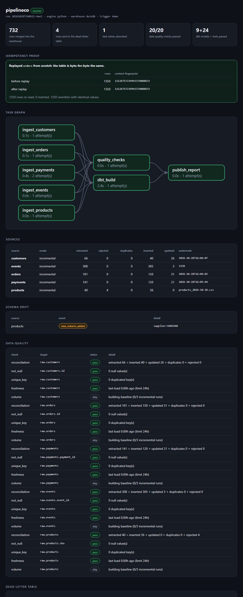
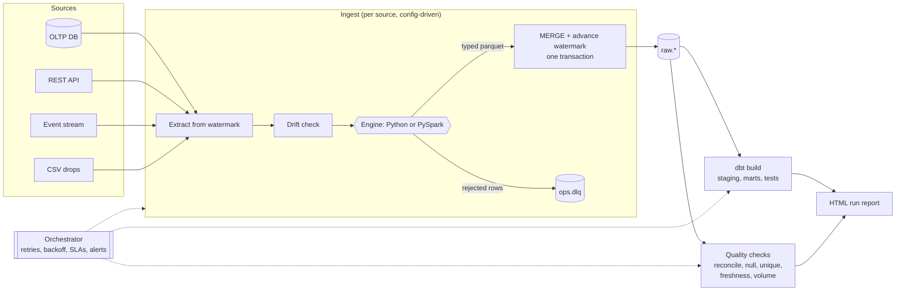
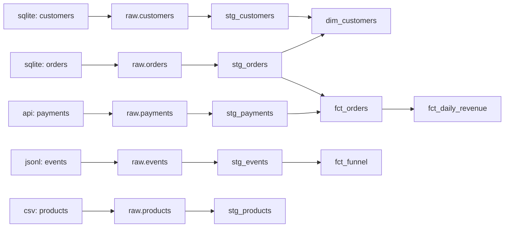

<div align="center">


**A reliability-first ingestion framework: sources to warehouse to dbt to run report.**
Runs free on DuckDB. Ships a real Snowflake adapter. One command shows every failure mode and how it is handled.


[](LICENSE)


</div>

## Try it

```bash
pip install git+https://github.com/MicoleKurt/pipelineco
pipelineco demo          # about 20 seconds, offline, free
pipelineco run --dry-run # plan, row estimates and Snowflake credits, loads nothing
```

No account, no Docker, no keys. The demo generates its own sources, runs the pipeline three times and writes a report:

<p align="center"></p>

## What the demo proves

| Failure mode | What happens | Where you see it |
|---|---|---|
| **Flaky upstream** | The mock API returns a real HTTP 503 on its first request. The task retries with exponential backoff and succeeds on attempt 2. | `retry ingest_payments`, "1 task retry absorbed" |
| **Bad rows** | Truncated JSON, `"N/A"` in a price column, a blank key. Each goes to a dead-letter table with the reason and the raw payload. The run carries on. | `ops.dlq`, "Dead-letter table" |
| **Duplicates** | At-least-once delivery replays events. They collapse to the latest version per key. | `dupes` column |
| **Schema drift** | A CSV drop arrives with a new `supplier` column. It is added as nullable `VARCHAR` and logged. A missing key column fails the source instead. | "Schema drift" |
| **Late data** | Events arrive days after their event time. The stream cursor is an offset, not a timestamp, so they are still picked up. | `events` row in run 2 |
| **Re-runs** | Replaying `orders` from scratch rewrites 1,350 rows and leaves the table byte-for-byte unchanged (content hash compared before and after). | "Idempotency proof" |
| **Lost rows** | Every run checks `extracted = inserted + updated + duplicates + rejected`. | Data quality: `reconciliation` |
| **Partial failure** | If an upstream task fails permanently, downstream tasks are skipped, an alert fires, and the report still publishes. | `tests/test_orchestrator.py` |

## Architecture

<p align="center"></p>



**The one design rule:** the watermark, the MERGE and the dead-letter rows commit in a single transaction. A crash at any point leaves the old watermark in place, so the next run re-reads the same window, and the keyed MERGE makes re-reading harmless.

## Lineage

Generated from dbt's manifest plus the declared sources (`pipelineco lineage`):



## Engines and warehouses

| | Default | Alternative |
|---|---|---|
| **Processing** | `python`: stdlib JSON, `pyarrow` | `spark`: PySpark with a PERMISSIVE JSON read, `try_cast`, window de-duplication. Same contract, same rejected rows. `pipelineco run --engine spark` (needs Java 17 and `pip install pyspark`) |
| **Warehouse** | DuckDB, `INSERT OR REPLACE` on the primary key | Snowflake: `PUT` to a stage, `COPY INTO` a temp table, `MERGE INTO`. Optional `CLUSTER BY` via `warehouse.cluster_by` |

### Snowflake setup

```bash
pip install "pipelineco[snowflake]"
export SNOWFLAKE_ACCOUNT=... SNOWFLAKE_USER=... SNOWFLAKE_PASSWORD=... SNOWFLAKE_WAREHOUSE=... SNOWFLAKE_DATABASE=...
pipelineco init            # then set `warehouse: { type: snowflake }` in pipelineco.yml
pipelineco run --config pipelineco.yml
dbt build --project-dir <workdir>/dbt_project --profiles-dir <workdir>/dbt_project --target snowflake
```

Credentials come from environment variables only. See [Verification status](#verification-status) for what has and has not been run against a live account.

## Orchestration

`pipelineco.pipeline.build_tasks` defines the graph once. `pipelineco run` executes it locally. [`dags/pipelineco_dag.py`](dags/pipelineco_dag.py) maps the same tasks onto Airflow operators with `retries`, `retry_exponential_backoff`, a task `sla`, a failure callback that alerts, and `trigger_rule="all_done"` on the report so it publishes even after a failure. `docker-compose.yml` starts Airflow with the DAG mounted.

Alerts go to the console, to `ops.alerts`, and to any Slack-compatible webhook in `PIPELINECO_WEBHOOK_URL`. A webhook outage never fails the pipeline.

## dry-run

```bash
pipelineco run --dry-run
```

Reads each source from its watermark, writes nothing to the warehouse, and prints the plan, row and MB estimates, and estimated Snowflake credits. The estimate states its assumptions (20,000 rows/s MERGE throughput, X-Small = 1 credit/hour, 60 s minimum billing); override them with `--rows-per-sec` and `--credits-per-hour`. It is an estimate, not a quote.

## Project layout

```
src/pipelineco/
  extract.py      sqlite, REST (paginated), JSONL offset, CSV drops
  engines.py      python and pyspark engines (one contract)
  ingest.py       drift check, process, MERGE, watermark, DLQ in one transaction
  warehouse/      DuckDB adapter, Snowflake adapter, pure Snowflake SQL builders
  quality.py      reconciliation, not-null, unique, freshness, volume anomaly
  orchestrator.py retries, backoff, SLAs, skip-on-upstream-failure, alerts
  pipeline.py     the task graph (shared by the CLI and the Airflow DAG)
  dbt_project/    staging and marts models, tests, source freshness
  report.py       self-contained HTML report (no scripts, no network)
dags/             Airflow DAG
tests/            28 tests, including a full 3-run pipeline with dbt
```

## Design decisions

- **Inclusive watermark plus idempotent MERGE** instead of a strict `>`: a row whose timestamp ties the watermark is never lost, and re-reading the boundary costs nothing.
- **Offset cursor for streams.** A timestamp watermark silently drops late events; an offset cannot.
- **Dead-letter, don't drop and don't halt.** One bad row should not stop 100,000 good ones, and it should never vanish. The raw payload is kept so it can be fixed and replayed.
- **Additive drift is automatic, breaking drift stops the source.** New columns are cheap to accept; a missing key means the contract is broken.
- **Volume anomaly warns, never fails**, and stays silent until it has 3 incremental runs of history, because a ratio against one sample is noise.
- **Two engines behind one contract** so the Spark path is a drop-in for batches that outgrow one process, with a test that both reject and keep the same rows.

## Verification status

What was run when this was built, on Windows with Python 3.11 (the author's laptop):

| Piece | Status |
|---|---|
| Ingest, MERGE, DLQ, drift, retries, quality checks, dbt build (9 models, 24 tests), HTML report | Run and tested (`pytest`, `pipelineco demo`) |
| Idempotent replay | Run and tested (content hash before = after) |
| Snowflake SQL generation | Unit-tested. **Not run against a live Snowflake account.** |
| Snowflake adapter (`PUT`/`COPY`/`MERGE` execution) | Written, **not executed** |
| PySpark engine | See the note below |
| Airflow DAG | Parse test runs in CI (`airflow-dag` job). **Not run locally**, Airflow does not install on Windows. `docker-compose.yml` is untested |
| Kafka / Kinesis | **Not used.** The JSONL file stands in for a topic and models offsets, duplicates and late data, not a broker |

Limits: the demo runs on thousands of rows, not billions. It is a reference implementation of the reliability patterns, not a benchmark or a production-proven platform.

## License

MIT
