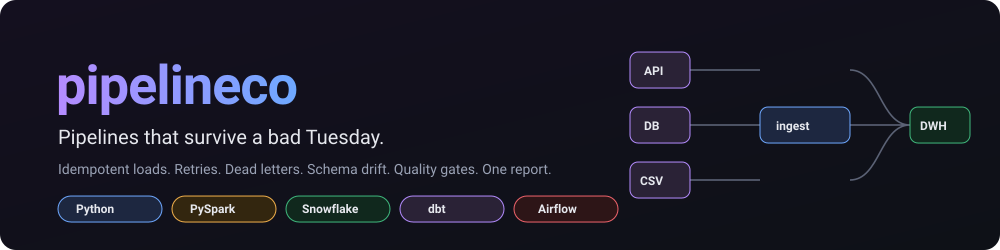
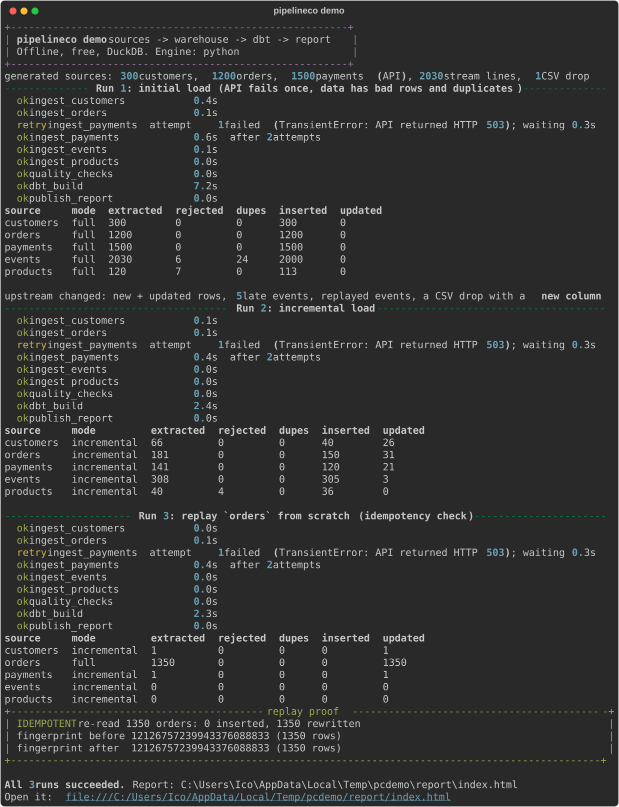
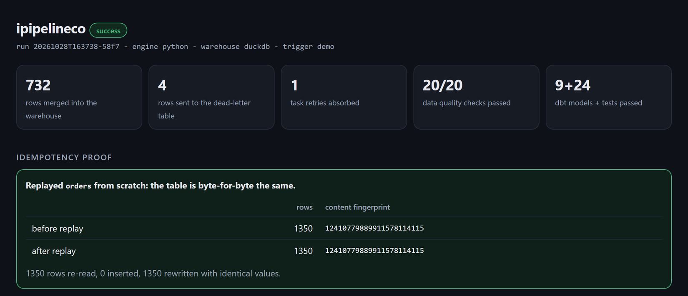
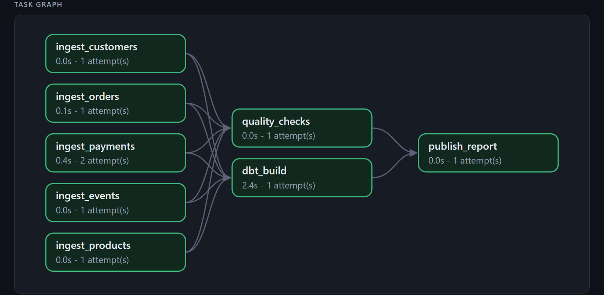
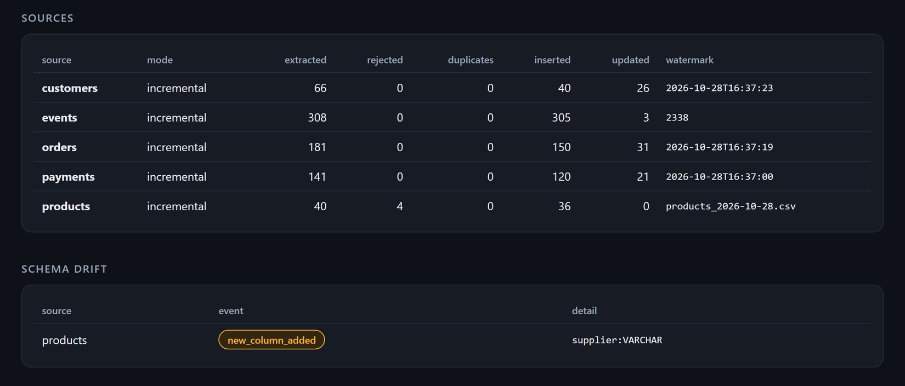
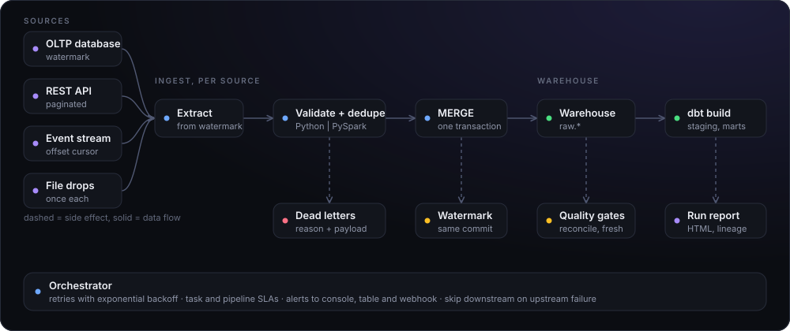
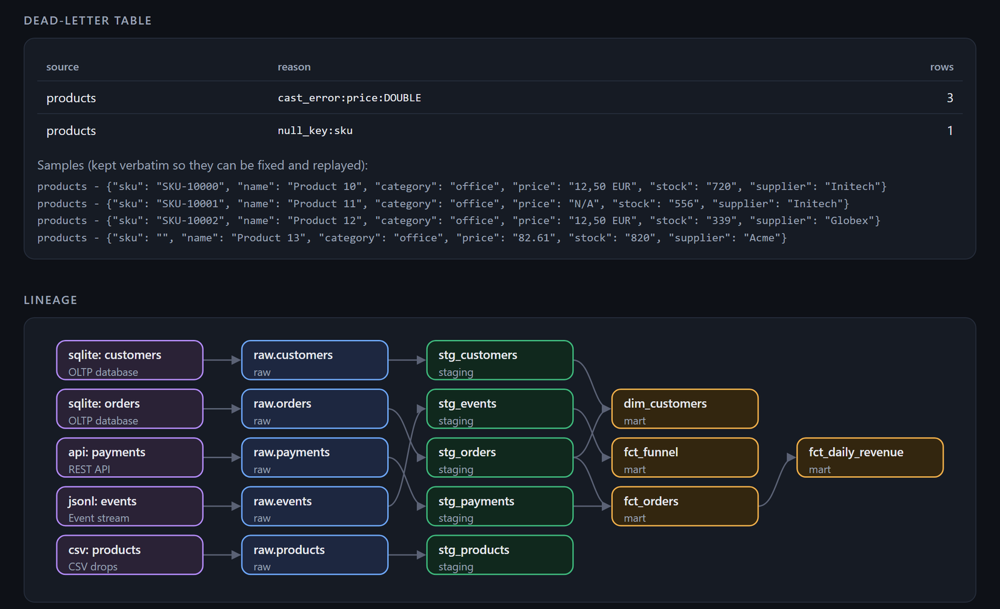

<div align="center">



<br>

**A reliability-first ingestion framework: sources to warehouse to dbt to one run report.**<br>
Free on DuckDB. Runs on Postgres and Supabase. Ships a Snowflake adapter. One command shows every failure mode and how it is handled.

[](https://github.com/MicoleKurt/ipipelineco/actions/workflows/ci.yml)

[](LICENSE)


<br>




<sub>`ipipelineco demo`: a real 503 from the API is retried, bad rows are dead-lettered, a new column is absorbed, and a full replay leaves the table byte-for-byte identical.</sub>

</div>

## Try it

```bash
pip install git+https://github.com/MicoleKurt/ipipelineco
ipipelineco demo           # about 20 seconds, offline, free
ipipelineco run --dry-run  # plan, row estimates and Snowflake credits. Loads nothing
```

No account, no Docker, no keys. The demo generates its own sources, runs the pipeline three times and writes a self-contained HTML report.

<p align="center"></p>
<p align="center"><sub>The report opens on what matters: rows merged, rows dead-lettered, retries absorbed, checks passed, and the replay proof (same row count, same content hash).</sub></p>

<p align="center"></p>
<p align="center"><sub>The task graph as it ran. <code>ingest_payments</code> took 2 attempts because the API answered 503 the first time.</sub></p>

## What the demo proves

| Failure mode | What happens | Where you see it |
|---|---|---|
| **Flaky upstream** | The mock API returns a real HTTP 503 on its first request. The task retries with exponential backoff and succeeds on attempt 2. | `retry ingest_payments` |
| **Bad rows** | Truncated JSON, `"N/A"` in a price column, a blank key. Each goes to a dead-letter table with its reason and raw payload. The run carries on. | `ops.dlq`, "Dead-letter table" |
| **Duplicates** | At-least-once delivery replays events. They collapse to the latest version per key. | `dupes` column |
| **Schema drift** | A CSV drop arrives with a new `supplier` column. It is added as nullable text and logged. A missing key column fails the source instead. | "Schema drift" |
| **Late data** | Events arrive days after their event time. The stream cursor is an offset, not a timestamp, so they are still picked up. | `events` row, run 2 |
| **Re-runs** | Replaying `orders` from scratch rewrites 1,350 rows and leaves the table unchanged (content hash compared before and after). | "Idempotency proof" |
| **Lost rows** | Every run checks `extracted = inserted + updated + duplicates + rejected`. | Data quality: `reconciliation` |
| **Partial failure** | If an upstream task fails permanently, downstream tasks are skipped, an alert fires, and the report still publishes. | `tests/test_orchestrator.py` |

<p align="center"></p>
<p align="center"><sub>Every extracted row is accounted for. The new <code>supplier</code> column shows up as a drift event rather than a failure.</sub></p>

## Architecture

<p align="center"></p>
<p align="center"><sub>Solid arrows move data. Dashed arrows are side effects. The orchestrator wraps every stage.</sub></p>

**The one design rule:** the watermark, the MERGE and the dead-letter rows commit in a single transaction. A crash at any point leaves the old watermark in place, so the next run re-reads the same window, and the keyed MERGE makes re-reading harmless.

## Lineage

<p align="center"></p>
<p align="center"><sub>Generated from dbt's manifest plus the declared sources (<code>ipipelineco lineage</code> prints it as Mermaid).</sub></p>

## Warehouses: DuckDB, Postgres, Supabase, Snowflake, or your own

The warehouse is an interface of about ten methods. Four implementations ship, and `register_warehouse` plugs in anything else.

| `warehouse.type` | Use it for | Load path |
|---|---|---|
| `duckdb` (default) | Free local runs, tests, the demo | `INSERT OR REPLACE` on the primary key |
| `postgres` / `supabase` | Supabase, Neon, RDS, Cloud SQL, any Postgres 12+ | `COPY` into a temp table, then `INSERT ... ON CONFLICT DO UPDATE` |
| `snowflake` | Snowflake | `PUT` to a stage, `COPY INTO` a temp table, `MERGE INTO`, optional `CLUSTER BY` |
| your own | BigQuery, MySQL, ClickHouse... | Subclass `Warehouse`, call `register_warehouse("name", factory)` |

### Supabase

```bash
pip install "ipipelineco[postgres]"
export SUPABASE_DB_URL="postgresql://postgres:<password>@db.<project>.supabase.co:5432/postgres"
ipipelineco init                      # then set  warehouse: { type: supabase }  in ipipelineco.yml
ipipelineco run --config ipipelineco.yml
```

- Use the **direct connection or the session pooler (port 5432)**. The transaction pooler (6543) does not keep session state and this adapter uses a temp table.
- Data lands in the `raw`, `ops`, `staging` and `marts` schemas. Supabase's Data API does not expose custom schemas by default, so the loaded data is not reachable through the public REST API unless you expose it.
- dbt runs against Postgres with `--target postgres`; the bundled task does this for you. It reads the standard `PGHOST`, `PGUSER`, `PGPASSWORD`, `PGDATABASE` variables.

### Snowflake

```bash
pip install "ipipelineco[snowflake]"
export SNOWFLAKE_ACCOUNT=... SNOWFLAKE_USER=... SNOWFLAKE_PASSWORD=... SNOWFLAKE_WAREHOUSE=... SNOWFLAKE_DATABASE=...
# ipipelineco.yml:  warehouse: { type: snowflake, cluster_by: { raw.orders: [updated_at] } }
```

Credentials come from environment variables only. See [Verification status](#verification-status).

### Bring your own database

```python
from ipipelineco.warehouse import Warehouse, register_warehouse

class MyWarehouse(Warehouse):
    ...  # execute, query, transaction, ensure_table, add_columns, merge_parquet, fingerprint, close

register_warehouse("mydb", lambda cfg: MyWarehouse(...))   # then: warehouse: { type: mydb }
```

## Processing engines

| `engine` | What it does |
|---|---|
| `python` (default) | stdlib JSON, `pyarrow`. Nothing else to install. |
| `spark` | PySpark: PERMISSIVE JSON read, `try_cast`, window de-duplication. Same contract, same rejected rows. `ipipelineco run --engine spark` (needs Java 17 and `pip install pyspark`). |

## Orchestration

`ipipelineco.pipeline.build_tasks` defines the graph once. `ipipelineco run` executes it locally. [`dags/ipipelineco_dag.py`](dags/ipipelineco_dag.py) maps the same tasks onto Airflow operators with `retries`, `retry_exponential_backoff`, a task `sla`, a failure callback that alerts, and `trigger_rule="all_done"` on the report so it publishes even after a failure. `docker-compose.yml` starts Airflow with the DAG mounted.

Alerts go to the console, to `ops.alerts`, and to any Slack-compatible webhook in `IPIPELINECO_WEBHOOK_URL`. A webhook outage never fails the pipeline.

## dry-run

`ipipelineco run --dry-run` reads each source from its watermark, writes nothing to the warehouse, and prints the plan, row and MB estimates, and estimated Snowflake credits. The estimate states its assumptions (20,000 rows/s MERGE throughput, X-Small = 1 credit/hour, 60 s minimum billing); override them with `--rows-per-sec` and `--credits-per-hour`. It is an estimate, not a quote.

## Project layout

```
src/ipipelineco/
  extract.py       sqlite, REST (paginated), JSONL offset, CSV drops
  engines.py       python and pyspark engines (one contract)
  ingest.py        drift check, process, MERGE, watermark, DLQ in one transaction
  warehouse/       DuckDB, Postgres/Supabase and Snowflake adapters, pure SQL builders, registry
  quality.py       reconciliation, not-null, unique, freshness, volume anomaly
  orchestrator.py  retries, backoff, SLAs, skip-on-upstream-failure, alerts
  pipeline.py      the task graph (shared by the CLI and the Airflow DAG)
  dbt_project/     staging and marts models, tests, source freshness
  report.py        self-contained HTML report (no scripts, no network)
dags/              Airflow DAG
scripts/           make_visuals.py regenerates the SVG diagrams
tests/             unit tests plus a full 3-run pipeline with dbt
```

## Design decisions

- **Inclusive watermark plus idempotent MERGE** instead of a strict `>`: a row whose timestamp ties the watermark is never lost, and re-reading the boundary costs nothing.
- **Offset cursor for streams.** A timestamp watermark silently drops late events; an offset cannot.
- **Dead-letter, don't drop and don't halt.** One bad row should not stop 100,000 good ones, and it should never vanish. The raw payload is kept so it can be fixed and replayed.
- **Additive drift is automatic, breaking drift stops the source.** New columns are cheap to accept; a missing key means the contract is broken.
- **Volume anomaly warns, never fails**, and stays silent until it has 3 incremental runs of history, because a ratio against one sample is noise.
- **Two engines behind one contract**, with a test that both keep and reject the same rows.

## Verification status

Built and run on Windows with Python 3.11.

| Piece | Status |
|---|---|
| Ingest, MERGE, DLQ, drift, retries, quality checks, dbt build on DuckDB (9 models, 24 tests), HTML report | Run and tested (`pytest`, `ipipelineco demo`) |
| Idempotent replay | Run and tested (content hash before = after) |
| **Postgres adapter** | Run against a real PostgreSQL server (embedded, via `pgserver`): merge, idempotent replay, schema drift, transaction rollback, dead letters, and the full pipeline including `dbt build` (9 models, 24 tests). CI repeats this against Postgres 16 and passes |
| **Supabase** | It is Postgres, so the adapter applies. **Not run against a live Supabase project.** The pooler note above comes from Supabase's documented behaviour, not from a test |
| Snowflake SQL generation | Unit-tested. **Not run against a live Snowflake account**, and the adapter's `PUT`/`COPY`/`MERGE` execution has not been executed |
| PySpark engine | Parity test with the Python engine (same rows kept, same rows rejected, same values) **passes in CI on Java 17**. Not run on the author's Windows machine, which has no Java |
| Airflow DAG | The DAG parses and its dependencies match the task graph: **passes in CI** with Airflow 2.10. Never started as a live scheduler. `docker-compose.yml` is untested |
| Kafka / Kinesis | **Not used.** A JSONL file stands in for a topic and models offsets, duplicates and late data, not a broker |

Limits: the demo runs on thousands of rows, not billions. It is a reference implementation of the reliability patterns, not a benchmark or a production-proven platform.

## License

MIT
